<!-- ═══════════════════════════════════════════════════════════════════════ -->
<!--                      SHADOW GARDEN — PROFILE README                     -->
<!-- ═══════════════════════════════════════════════════════════════════════ -->

<div align="center">

<!-- ░░░ ANIMATED WAVE HEADER ░░░ -->


<!-- ░░░ ANIMATED TYPING ░░░ -->
<a href="https://github.com/shadowgarden012">
  
</a>

<br/>

<!-- ░░░ STATUS BADGES (Clean ASCII URLs for 100% Camo compatibility) ░░░ -->
<p>
  
  &nbsp;
  
  &nbsp;
  
  &nbsp;
  
</p>

<!-- ░░░ SOCIAL BADGES ░░░ -->
<p>
  <a href="https://github.com/shadowgarden012?tab=followers"></a>
  &nbsp;
  <a href="https://linkedin.com/in/shadowgarden"></a>
  &nbsp;
  <a href="https://twitter.com/shadowgarden012"></a>
  &nbsp;
  <a href="https://discord.gg/shadow"></a>
  &nbsp;
  <a href="mailto:shadow@shadowgarden.dev"></a>
</p>

<br/>


</div>

<br/>

<!-- ░░░ BLACK HOLE SINGULARITY ANIMATION ░░░ -->

<div align="center">
  
</div>

<br/>

<!-- ░░░ WHO AM I ░░░ -->

## 🔮 `$ shadow --whoami`

```bash
╔══════════════════════════════════════════════════════════════════╗
║                   SHADOW GARDEN — IDENTITY MATRIX                ║
╠══════════════════════════════════════════════════════════════════╣
║  codename     :  "Shadow"                                        ║
║  org          :  Shadow Garden 🌑                                ║
║  roles        :  Full-Stack Architect                            ║
║                  AI/ML Engineer & LLM Orchestrator               ║
║                  Cloud-Native & DevOps Engineer                  ║
║                  Cybersecurity Researcher                         ║
║                  Low-Level Systems & Compiler Wizard             ║
║                  Blockchain & Web3 Developer                     ║
║  philosophy   :  "Build in the shadows. Ship in the light."      ║
║  status       :  [ ████████████████░░░░ ] Compiling reality...   ║
╚══════════════════════════════════════════════════════════════════╝
```

<details>
<summary><b>🕵️ Decrypt Classified Dossier (Environment & Telemetry)</b></summary>
<br/>

```yaml
operating_system : Arch Linux (Hyprland) / Kali Linux / Windows WSL2
terminal         : Kitty + Zsh + Starship + Tmux
editor           : Neovim (LazyVim) & VS Code
primary_focus    : Autonomous AI Agents, Distributed Systems & AppSec
currently_into   : Rust async internals, eBPF observability & Local LLMs
fun_fact         : "I debug production at 3 AM with dark roast and zero logs."
```

</details>

<br/>

<br/>

<!-- ░░░ ANIMATED STATS SECTION ░░░ -->

## 📊 `$ shadow --stats --live`

<div align="center">

<!-- TROPHIES -->


<br/><br/>

<!-- PROFILE SUMMARY TIMELINE -->


<br/><br/>

<!-- STATS + STREAK SIDE BY SIDE -->
<table>
<tr>
<td width="50%">
  
</td>
<td width="50%">
  
</td>
</tr>
<tr>
<td colspan="2" align="center">
  
</td>
</tr>
</table>

</div>

<br/>

<br/>

<!-- ░░░ ACTIVITY GRAPH ░░░ -->

## 📈 `$ shadow --activity-graph`

<div align="center">
  
</div>

<br/>

<!-- ░░░ SNAKE ANIMATION ░░░ -->

## 🐍 `$ shadow --contribution-snake`

<div align="center">
  <picture>
    <source media="(prefers-color-scheme: dark)" srcset="https://raw.githubusercontent.com/shadowgarden012/shadowgarden012/output/github-contribution-grid-snake-dark.svg"/>
    <source media="(prefers-color-scheme: light)" srcset="https://raw.githubusercontent.com/shadowgarden012/shadowgarden012/output/github-contribution-grid-snake.svg"/>
    
  </picture>
</div>

<br/>

<br/>

<!-- ░░░ TECH STACK ░░░ -->

## ⚡ `$ shadow --arsenal --all`

<div align="center">

<!-- GLOSSY ICON GRID -->
<p>
  
</p>

<br/>

<!-- LANGUAGES -->
<details open>
<summary><b>💻 Core Languages</b></summary>
<br/>


</details>

<br/>

<!-- FRONTEND -->
<details>
<summary><b>🎨 Frontend & UI (Click to expand)</b></summary>
<br/>


</details>

<br/>

<!-- BACKEND -->
<details>
<summary><b>⚙️ Backend & APIs (Click to expand)</b></summary>
<br/>


</details>

<br/>

<!-- AI/ML -->
<details>
<summary><b>🧠 AI, ML & Intelligence (Click to expand)</b></summary>
<br/>


</details>

<br/>

<!-- CLOUD/DEVOPS -->
<details>
<summary><b>☁️ Cloud, DevOps & Infra (Click to expand)</b></summary>
<br/>


</details>

<br/>

<!-- DATABASES -->
<details>
<summary><b>🗄️ Databases & Storage (Click to expand)</b></summary>
<br/>


</details>

<br/>

<!-- SECURITY -->
<details>
<summary><b>🛡️ Security & Hacker Toolkit (Click to expand)</b></summary>
<br/>


</details>

</div>

<br/>

<br/>

<!-- ░░░ FEATURED PROJECTS ░░░ -->

## 🌌 `$ shadow ls ./vault/`

<div align="center">

<table>
<tr>
<td width="50%">

### 🤖 Autonomous-Agent-Core
> Multi-agent orchestration engine with adaptive memory, self-healing DAG workflows & autonomous tool selection


**Status:** `🟢 Deployed`

</td>
<td width="50%">

### 🛡️ Sentinel-Mesh
> Zero-trust distributed microservices telemetry & automated threat mitigation at network edges


**Status:** `🟢 Active`

</td>
</tr>
<tr>
<td width="50%">

### ⚡ Shadow-Stream-Engine
> Ultra-low latency event streaming & real-time processing pipeline for sub-millisecond analytics


**Status:** `🟡 Optimizing`

</td>
<td width="50%">

### 🔮 Quantum-UI
> Hyper-customizable dark-mode cyberpunk design system with physics-based micro-animations


**Status:** `🚀 Shipped`

</td>
</tr>
</table>

</div>

<br/>

<br/>

<!-- ░░░ SKILLS METER ░░░ -->

## 🎯 `$ shadow --skill-matrix`

```
Full-Stack Engineering      ████████████████████  100%
Cloud Architecture          ██████████████████░░   90%
AI / ML Engineering         █████████████████░░░   85%
Cybersecurity               ████████████████░░░░   80%
Blockchain / Web3           ██████████████░░░░░░   70%
Low-Level Systems           ████████████████░░░░   80%
DevOps / SRE                ██████████████████░░   90%
UI/UX Design                █████████████░░░░░░░   65%
```

<br/>

<!-- ░░░ RANDOM DEV QUOTE ░░░ -->

<div align="center">
  
</div>

<br/>

<br/>

<!-- ░░░ FOOTER ░░░ -->

## 💬 `$ shadow --contact`

<div align="center">

```
╔══════════════════════════════════════════════════════════════╗
║  Whether you want to collaborate on open-source, build       ║
║  next-gen AI systems, or just nerd out on systems design —   ║
║  the channel is always open.                                 ║
║                                                              ║
║  > linkedin   : linkedin.com/in/shadowgarden                 ║
║  > twitter    : @shadowgarden012                             ║
║  > discord    : discord.gg/shadow                            ║
║  > email      : shadow@shadowgarden.dev (PGP encrypted)      ║
║  > portfolio  : shadowgarden.dev                             ║
╚══════════════════════════════════════════════════════════════╝
```

<br/>

> *"I am that which lurks in the abyss between packets. I am the silence between commits."*

<br/>

<!-- WAVE FOOTER -->


</div>
